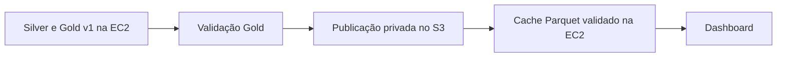

# Execução local ou AWS com os dados existentes

Selecionar a infraestrutura por `--infra local|aws`. O modo AWS executa **no host EC2 em que
o comando é chamado**; não cria recursos nem envia comandos remotamente à AWS.

| Modo | Serviços | Dados |
|---|---|---|
| `local` | Compose atual: Airflow, metadados e dashboard; PostGIS externo existente | `data/` local |
| `aws` | Airflow + metadados + dashboard numa única EC2; PostGIS opcional | Processamento em `data/`; dashboard lê publicação S3 em cache separado |

Usar Bronze **e Silver/Gold já processados**. Os comandos abaixo não ingerem nem recalculam dados.
Local usa a view `gold.water_stress_dashboard`; AWS lê Parquet publicado no S3. Ambos usam score v1. Airflow permanece
manual, sem agendamento. O piloto v2 é preservado nos arquivos e separado do painel; sua publicação
relacional continua explícita conforme [score_v2.md](score_v2.md).

## Local

Com Docker iniciado e `.env`/`.env.airflow` preparados conforme [airflow.md](airflow.md):

```bash
uv run python -m water_stress.pipelines.run_infrastructure --infra local up
uv run python -m water_stress.pipelines.run_infrastructure --infra local status
uv run python -m water_stress.pipelines.run_infrastructure --infra local stop
```

Preserva o projeto Compose e os volumes atuais. `load` é opcional quando houver necessidade
de atualizar o PostGIS existente. Todos os comandos de serviço aceitam `--env-file CAMINHO`.

## Preparar AWS Academy

Criar no console um bucket S3 privado, com bloqueio de acesso público, e uma EC2 Linux x86_64
com EBS gp3. Começar com `t3.large` (8 GiB) e 40 GiB de disco, se permitidos pelo laboratório;
medir memória antes de transformar o estado. Usar a mesma região, por exemplo `us-east-1`, se
liberada. Associar `LabInstanceProfile`, quando disponível, para acesso ao S3 sem copiar chaves.
Restringir SSH ao seu IP. PostgreSQL, Streamlit e Airflow não recebem portas públicas.
Conferir as restrições no guia do próprio Lab.

Na EC2, instalar Git, Docker/Compose **>=2.24.4**, AWS CLI v2, Python 3.12 e `uv`.
Para uma EC2 Ubuntu 24.04 x86_64 nova, usar o bootstrap incluído (também pode ser informado
como user data no lançamento, sem incluir credenciais):

```bash
sudo bash deployment/aws/bootstrap_ubuntu.sh
```

Reconectar o SSH depois da instalação para ativar o grupo Docker. O script prepara somente
as ferramentas do host; não inicia serviços, baixa datasets ou cria recursos AWS.

Obter uma cópia do código atual; incluir alterações ainda não publicadas no Git, sem `.env*`,
`.venv/`, `.git/`, `.deployment/` ou `data/`. Não é necessário fazer commit/push para esse fluxo.
Referências: [Docker no Ubuntu](https://docs.docker.com/engine/install/ubuntu/),
[AWS CLI](https://docs.aws.amazon.com/cli/latest/userguide/getting-started-install.html),
[uv](https://docs.astral.sh/uv/getting-started/installation/).

## Publicar na máquina local

Parar escritores antes da transferência. Configurar AWS CLI com as credenciais temporárias do
Learner Lab, incluindo `AWS_SESSION_TOKEN`, somente no terminal ou no arquivo de credenciais AWS.
Não colocar credenciais no repositório nem em `.env.aws`.

Na raiz do projeto, substituir `SEU_BUCKET` pelo nome real em minúsculas:

```bash
uv run python -m water_stress.pipelines.run_infrastructure --infra local stop
uv run python -m water_stress.pipelines.run_infrastructure \
  --infra aws --bucket SEU_BUCKET --region us-east-1 publish-data
```

Guardar o `snapshot_id` impresso. O destino é
`s3://<bucket>/water-stress/snapshots/<snapshot_id>/`, com `data/bronze/`, `data/silver/`,
`data/gold/` e `manifest.json`. `--prefix` permite trocar o prefixo `water-stress`.

O contrato `data-snapshot-v1` tem uma entrada por caminho relativo único, tamanho em bytes e
SHA-256, com timestamp UTC. Metadados dos datasets preservam unidades, CRS, cobertura, fontes e
versões. O ID deriva do inventário ordenado e checksums, independentemente do timestamp.
As três camadas precisam conter arquivos. Arquivos ocultos/`*.tmp` são excluídos e links simbólicos
são recusados. O manifesto é publicado por último; sem ele o snapshot não é consumível.
Snapshots completos são reutilizados; dados alterados geram outro ID. Tentativas incompletas
recopiam os arquivos, evitando inferir integridade apenas por tamanho ou timestamp.
Não há exclusão remota nem limpeza automática de snapshots.

## Restaurar e iniciar na EC2

Na raiz da cópia do projeto:

```bash
uv sync --frozen
uv run python -m water_stress.pipelines.run_infrastructure \
  --infra aws --bucket SEU_BUCKET --region us-east-1 \
  --snapshot ID_IMPRESSO_NA_PUBLICACAO fetch-data
cp deployment/aws/aws.env.example .env.aws
# Permitir escrita pelo usuário 50000 da imagem Airflow em Linux:
sudo chown -R 50000:0 data
```

Editar `.env.aws`: preencher `AIRFLOW_METADATA_PASSWORD` (somente letras/números) e
`WATER_STRESS_DATABASE__PASSWORD`. Não copiar o `.env` do banco local. O serviço `postgis`
fica disponível apenas no perfil opcional `database`; manter suas credenciais separadas para
esse uso legado. `metadata-db` continua exclusivo do Airflow. Preencher também o bucket,
prefixo e região `WATER_STRESS_DASHBOARD__LOCATION__*` do exemplo. Depois:

```bash
uv run python -m water_stress.pipelines.run_infrastructure --infra aws up
docker compose --env-file .env.aws --project-name water-stress-aws \
  -f compose.airflow.yml -f compose.aws.yml run --rm --no-deps \
  --entrypoint /opt/pipeline-venv/bin/python airflow \
  -m water_stress.pipelines.run_dashboard_publication --config configs/project.yml
uv run python -m water_stress.pipelines.run_infrastructure --infra aws status
```

`up` constrói a imagem e espera healthchecks. O comando de publicação acima usa os arquivos
existentes, sem ingestão, transformação ou carga no PostgreSQL.
O projeto Compose AWS é `water-stress-aws`, com volumes próprios. PostGIS fica no perfil
opcional `database`; não é iniciado pelo fluxo S3, e seu volume anterior é preservado.
O PostgreSQL `metadata-db` continua obrigatório exclusivamente para o Airflow.

## Publicação S3 e cache do dashboard



A role `LabInstanceProfile` deve poder ler/escrever objetos no bucket. Para containers usarem
IMDSv2 sem copiar credenciais, configurar `HttpTokens=required` e hop limit `2` na EC2,
conforme a [recomendação AWS](https://docs.aws.amazon.com/AWSEC2/latest/UserGuide/configuring-IMDS-new-instances.html).
O SDK oficial usa timeout de conexão de 10 s, leitura de 60 s e até três tentativas transitórias.
O bucket permanece privado; os navegadores acessam somente o servidor Streamlit.

O contrato `dashboard-snapshot-v1` preserva os arquivos originais da grade Silver e da Gold v1,
incluindo todos os Parquet semanais e seus metadados/schema/qualidade. Os grãos, chaves, CRS,
unidades e regras são os contratos originais; não há reamostragem, nova fórmula nem v2.
O manifesto registra estudo, timestamp UTC, caminhos relativos, tamanhos e SHA-256.
O ID deriva do estudo e inventário, sem o timestamp de publicação.

Objetos ficam em `s3://<bucket>/water-stress/dashboard/snapshots/<id>/data/`.
O manifesto imutável é escrito após os arquivos; `current.json` é atualizado por último.
Publicações completas são reutilizadas; uma interrupção mantém o ponteiro anterior válido.
Não apagar o bucket nem snapshots existentes para repetir uma execução.

O dashboard baixa somente essa publicação para o volume `dashboard-cache`, separado de `data/`
e dos bancos. Verifica inventário/estudo/SHA-256 e promove o diretório somente ao concluir.
Downloads interrompidos retomam arquivos íntegros. Revisões prontas são reutilizadas e conferidas;
uma corrupção é recusada, sem fallback para PostgreSQL ou arquivos do pipeline.
Um lock local serializa downloads simultâneos; o cache requer host Linux/macOS.
O ponteiro é consultado com cache de até 60 s; “Atualizar leitura” força a consulta.
Cada revisão ocupa disco adicional; remover revisões antigas do cache somente quando não estiverem
em uso, preservando os originais e as publicações S3. Não há limpeza automática destrutiva.

Para executar via Airflow, despausar `water_stress_pipeline` e disparar:

```json
{"mode":"gold-only","load_database":false}
```

O fluxo AWS segue Gold v1 → gate → `publish_dashboard`. A opção `load_database` controla
somente o ramo local; na AWS a publicação é S3. `full` e `satellite-gold` permanecem disponíveis,
mas são mais demorados e podem acessar fontes externas. Gold reutiliza checkpoints válidos.
Não disparar se a intenção for apenas abrir o dashboard: a publicação inicial já pode ser feita
pelo CLI acima. Bronze/Silver/Gold usados para processamento continuam no disco da EC2;
a integração S3 aqui é publicação/consumo, sem processamento distribuído.

## Acessar e encerrar

No computador local, abrir um túnel (exemplo para Ubuntu; ajustar usuário conforme a AMI):

```bash
ssh -i CAMINHO_DA_CHAVE.pem \
  -L 8501:127.0.0.1:8501 -L 8080:127.0.0.1:8080 ubuntu@IP_PUBLICO_DA_EC2
```

Abrir `http://localhost:8501` e `http://localhost:8080`. Se a porta local estiver ocupada,
usar, por exemplo, `-L 18501:127.0.0.1:8501` e acessar `http://localhost:18501`.
Para consultar a senha do Airflow, executar **somente no seu terminal da EC2**:

```bash
docker compose --env-file .env.aws --project-name water-stress-aws \
  -f compose.airflow.yml -f compose.aws.yml \
  exec airflow cat /opt/airflow/simple_auth_manager_passwords.json.generated
```

Ao terminar, executar `uv run python -m water_stress.pipelines.run_infrastructure --infra aws stop`
e **parar a EC2 no console**. Parar containers não encerra a cobrança da instância; EBS/S3 continuam
cobrando armazenamento. Evitar NAT Gateway, IP elástico e serviços adicionais. Exportar arquivos
antes do fim do Lab. Auditoria relacional e histórico do Airflow não integram o snapshot `data/`.

## Falhas e limites

- Download usa `.deployment/<snapshot_id>/` e valida inventário/SHA-256 antes de instalar arquivos
  por rename. Reservar espaço adicional aproximadamente igual ao snapshot. Não iniciar escritores
  durante transferência. A instalação é atômica por arquivo, não entre todas as camadas.
- Interrupções podem deixar arquivos completos instalados: repetir `fetch-data` conclui a restauração.
  `data/.snapshot.json` é escrito somente ao concluir; AWS `up`/`load` exigem esse registro.
- Destinos conflitantes são recusados, incluindo Bronze. Usar uma cópia limpa do projeto;
  não apagar os dados originais para resolver conflitos.
- AWS CLI tem timeout de conexão/leitura e até três tentativas padrão por requisição. Comandos
  externos têm limite de uma hora; após timeout, verificar estado antes de repetir.
- Transformadores continuam usando disco da EC2; o dashboard usa S3 via cache.
  Não há execução distribuída ou alta disponibilidade.
- Erros não reproduzem stderr de ferramentas, que pode conter segredos. Diagnosticar no terminal.
  Logs: `docker compose --env-file .env.aws --project-name water-stress-aws -f compose.airflow.yml -f compose.aws.yml logs --tail 100`.

Testes usam fixtures sintéticas e AWS CLI mockada, sem rede. Validar restauração/carga real no Lab
antes da entrega; permissões e conectividade dependem da conta. Referências:
[credenciais por ambiente](https://docs.aws.amazon.com/cli/latest/userguide/cli-configure-envvars.html),
[merge do Compose](https://docs.docker.com/reference/compose-file/merge/).

## Validação real no Learner Lab — 10/10/2026

Esta seção registra a implantação inicial com PostGIS na EC2. O consumo do dashboard foi
posteriormente alterado para S3; a validação desse fluxo consta na seção seguinte.

Implantação em `us-east-1`, com Ubuntu 24.04, EC2 `t3.large`, EBS gp3 de 40 GiB criptografado,
`LabInstanceProfile`, S3 privado com AES256 e acesso às aplicações por túnel SSH. Restaurados
1.687 arquivos (1.299.301.251 bytes), com inventário e SHA-256 conferidos. Repetir a publicação
reutilizou o mesmo snapshot.

| Tabela | Registros conferidos com os Parquet locais |
|---|---:|
| `silver.dim_spatial_grid` | 907.671 |
| `silver.crop_mask` | 907.671 |
| `silver.soil_features` | 907.671 |
| `silver.weather_daily` | 58.563 |
| `silver.satellite_observation` | 546.182 |
| `gold.water_stress_weekly` | 4.839.624 |

Aplicadas migrations 001–004 e registrados 391 manifestos Bronze. Conferidas 36 semanas e
equivalência dos indicadores PostgreSQL/Parquet na primeira e na última semana, com tolerância
numérica de `1e-8`. Repetir a carga de clima manteve 58.563 registros. Airflow autenticado,
com o DAG pausado, zero erros de importação e zero execuções.

O painel renderizou mapa e indicadores da semana de 01/01/2024: score médio 4,1, área em alto
ou crítico de 261 km² e cobertura completa de 12,0%. A listagem de semanas foi otimizada para
consultar a Gold diretamente, preservando período/grade e a equivalência garantida pela chave
estrangeira; a consulta levou aproximadamente 1,7 s no modo Standard. Os indicadores continuam
usando a view existente. Nenhuma ingestão ou transformação foi repetida.

AppTest do Streamlit executado na EC2 com PostgreSQL real validou visão geral, página Sobre,
filtro Completo e seleção das semanas inicial/final, com scores 54,9 e 33,3. O teste confirmou
que o filtro de completude mantém o score geral da semana. Suíte local: 222 testes aprovados,
1 módulo Airflow ignorado, cobertura de 90,17%; Ruff, formatação e mypy aprovados.
No navegador, também passaram visão geral, página Sobre, filtro Completo e troca para as
semanas inicial/final, sem erros de JavaScript. Capturas e relatórios estão em `.deployment/`.
Parar e ligar a mesma EC2 preservou as seis contagens; serviços e painel voltaram saudáveis,
com os mesmos indicadores e acesso pelo novo IP. O comando local de acesso foi testado.

Identificadores dos recursos, chave SSH, relatórios e capturas ficam em `.deployment/`, ignorado
pelo Git; senhas geradas permanecem na EC2. Essas evidências descrevem esta implantação,
sem garantir disponibilidade futura dos recursos do laboratório.

## Validação do dashboard S3 — 10/10/2026

Publicados e conferidos 41 arquivos (143.755.448 bytes) em `water-stress/dashboard`, incluindo
36 semanas Gold v1. Após um disparo real `gold-only`, snapshot final
`40939c03101c8b9aa741d11e87ed15556b6473bcfec4cfba9586c4340b1a6f72`.
Execução `validation_s3_v1_20261011` concluída com sucesso: seleção de modo, Gold,
gate, seleção de publicação e `publish_dashboard`. Ingestão, transformação Silver e carga
relacional ignoradas. A pausa do DAG foi restaurada depois do teste.

PostGIS antigo da EC2 foi parado e seu autoinício desabilitado, preservando o volume.
Airflow, seu PostgreSQL de metadados e dashboard permaneceram saudáveis. AppTest validou
visão geral, Sobre, filtro Completo e semanas inicial/final, bloqueando qualquer consulta
PostgreSQL. Navegador confirmou mapa, filtros e navegação sem erros JavaScript.
Leitura da publicação final conferiu 134.434 células em cada semana selecionada, com scores
54,9 / 4,1 / 33,3 e as mesmas áreas/coberturas da validação anterior.

237 testes padrão aprovados, 1 módulo Airflow ignorado, cobertura 90,50%; 14 testes Airflow
aprovados com classes reais. Ruff, formatação, mypy e diff aprovados. Relatórios e capturas
ficam em `.deployment/`, sem credenciais. Não foram alterados o banco local nem objetos do
snapshot S3 original. EC2 permanece ligada para acesso; parar ao terminar para economizar créditos.
